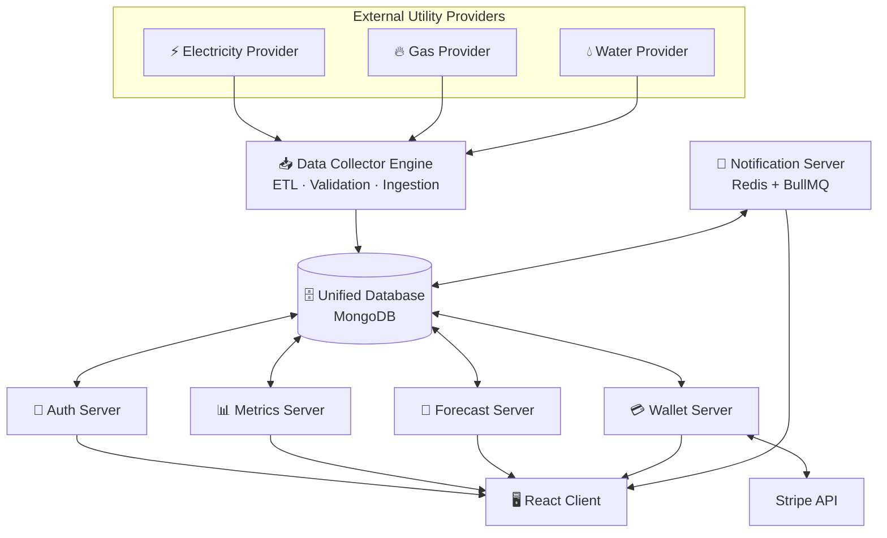

<div align="center">


# ⚡ Addadak (عدّادك)

### Smarter Utilities, Better Life

A microservices-based **smart utility management and ML forecasting platform** for **Electricity, Gas and Water** consumption.


[Overview](#-overview) · [Demo](#-demo) · [Architecture](#-architecture) · [Services](#-services) · [Features](#-features) · [Getting Started](#-getting-started) · [Roadmap](#-roadmap) · [Team](#-team)

</div>

---

## 📌 Overview

**Addadak (عدّادك)** is a full-stack, distributed platform for monitoring, forecasting and paying for smart-meter utilities: **electricity, gas and water**, all in one place.

It is designed around three types of users:

| User | What they get |
|------|---------------|
| 🏠 **Individual consumers** | Real-time visibility into every meter, tier boundaries, and instant bill payment. |
| 🏢 **Business users** | Usage tracking across multiple branches with aggregated analytics to avoid surprise bills. |
| 🏭 **Utility providers** | Fewer estimated-billing errors, faster collections, and lower peak-demand stress through demand analytics. |

---

## 🏗️ Architecture

Addadak follows a **modular microservices architecture** with a **shared MongoDB database** and an automated **Data Collector** that ingests readings from multiple utility providers.



---

## 🔄 Services

### 📥 Data Collector
The central ingestion engine. It periodically connects to the Electricity, Gas and Water provider endpoints (real servers or simulators), pulls reading batches, **validates and sanitizes** the payloads, and stores them in the unified database.

### ⚙️ Microservices

| Service | Folder | Responsibility |
|---------|--------|----------------|
| 🔑 **Auth** | `BE/AuthServer` | Identity management, authentication, role-based access control, user profiles. |
| 📊 **Metrics** | `BE/MetricsServer` | Reads ingested utility data, calculates consumption tiers, builds historical usage logs. |
| 🤖 **Forecast** | `BE/ForecastServer` | ML models that predict future consumption and bill amounts from historical data. |
| 💳 **Wallet & Billing** | `BE/walletServer` | Digital wallet, invoicing, and secure payments through **Stripe**. |
| 🔔 **Notifications** | `BE/notificationServer` | Event-driven alerts (low balance, usage spikes, tier breaches) using **Redis + BullMQ**. |
| 🧪 **Mock Provider** | `BE/Electricity_Company_Fake_Server` | Simulated electricity provider API for development and testing. |

---

## ✨ Features

- 📈 **Multi-utility dashboard**: one real-time view for electricity, gas and water meters.
- 🔄 **Automated data ingestion**: continuous background collection from multiple providers.
- 🤖 **ML forecasting**: estimates next month's consumption and expected cost before the bill arrives.
- 🎯 **Tier tracking**: visual badges and progress indicators for national tariff tiers.
- 🔌 **Appliance-level insights**: breakdown of individual device consumption.
- 💸 **Instant payments**: one-click bill settlement via wallet and Stripe.
- 🚨 **Proactive alerts**: automatic notifications for low balance and unusual usage spikes.

---

## 🛠️ Tech Stack

| Layer | Technologies |
|-------|--------------|
| **Frontend** | React.js, Tailwind CSS, Chart.js / Recharts, Axios |
| **Backend** | Node.js, Express.js, REST APIs, JWT |
| **Machine Learning** | Python, NumPy, Pandas, Scikit-Learn |
| **Data** | MongoDB (Mongoose), Redis |
| **Async / Queues** | BullMQ |
| **Payments** | Stripe API |
| **DevOps** | Docker, Nginx, GitHub Actions |

---

## 📂 Repository Structure

```text
Addadak/
├── BE/                                  # Backend ecosystem
│   ├── AuthServer/                      # Authentication & user management
│   ├── MetricsServer/                   # Consumption & meter data
│   ├── ForecastServer/                  # ML prediction engine
│   ├── walletServer/                    # Billing, invoicing, Stripe
│   ├── notificationServer/              # Redis-backed alerts
│   ├── Data Collector/                  # Multi-provider ingestion & schedulers
│   └── Electricity_Company_Fake_Server/ # Mock provider API
├── FE/
│   └── addadak/                         # React single-page app
├── Paper Work/                          # Diagrams & documentation
├── logs/                                # System error & event logs
└── README.md
```

---

## 🚀 Getting Started

### Prerequisites

- **Node.js** v18 or later
- **Python** 3.9 or later (Forecast Server)
- **MongoDB** (local instance or Atlas cluster)
- **Redis** (notification queues)
- **Docker & Docker Compose** *(optional)*

### 1. Clone the repository

```bash
git clone https://github.com/your-username/Addadak.git
cd Addadak
```

### 2. Configure environment variables

Create a `.env` file inside **each** service folder under `BE/`. Example:

```env
# Shared
MONGO_URI=mongodb://localhost:27017/addadak
PORT=5000

# Auth
JWT_SECRET=change_me

# Wallet
STRIPE_SECRET_KEY=sk_test_xxx

# Notifications
REDIS_HOST=127.0.0.1
REDIS_PORT=6379
```

> 🔒 Never commit `.env` files. Make sure they are listed in `.gitignore`.

### 3. Run the backend

Start each service in its own terminal:

```bash
# Data Collector
cd "BE/Data Collector"
npm install
npm run dev

# Auth, Metrics, Wallet, Notification (repeat for each)
cd BE/AuthServer
npm install
npm run dev

# Forecast Server (Python)
cd BE/ForecastServer
pip install -r requirements.txt
python app.py
```

### 4. Run the frontend

```bash
cd FE/addadak
npm install
npm start
```

Open **http://localhost:3000** in your browser.

---

## 🎬 Demo

<div align="center">

<video src="Addadak-Demo.mp4](https://github.com/user-attachments/assets/487c93c6-6284-44a7-adcd-f6b4d3a01aab" controls muted width="100%"></video>

</div>

> If the player does not load in your viewer, [click here to watch the demo](./Addadak-Demo.mp4).

---

## 🔮 Roadmap

- [ ] **IoT ingestion**: direct MQTT telemetry from physical smart meters into the Data Collector
- [ ] **Mobile app**: React Native client for iOS and Android
- [ ] **Unified bill payment**: pay all three utilities in a single transaction
- [ ] **Smart tariff optimizer**: AI suggestions to shift heavy appliance use to off-peak hours

---

## 👥 Team

| Member | Role | GitHub |
|--------|------|--------|
| **Toka Mamdouh** | Founder & Team Leader | [@Toka999](https://github.com/Toka999) |
| **Abdelrahman Anter** | Team Member | [@abdalrhmananter-hub](https://github.com/abdalrhmananter-hub) |
| **Amira Hamada** | Team Member | [@AmiraDeef](https://github.com/AmiraDeef) |
| **Maiar Emam** | Team Member | [@maiar38](https://github.com/maiar38) |
| **Sarah Abdelsamie** | Team Member | [@sarahabdelsamie](https://github.com/sarahabdelsamie) |

### 🏛️ Supervision & Host Institutions

**National Telecommunication Institute (NTI)** · DiGilians Program · **Ministry of Communications and Information Technology (MCIT)** · Egyptian Military Academy

---

## 📄 License

Distributed under the **MIT License**. See `LICENSE` for details.

<div align="center">
<sub>Built with ❤️ by the Addadak Team</sub>
</div>
